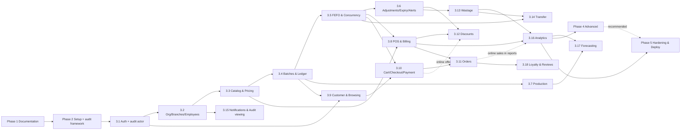

# BakeFlow – Feature Roadmap

> **Step:** 1.1 (owner-reviewed) · **Source:** Official roadmap from the Phase 1.1 prompt (supersedes the Phase 0–12 numbering in [master-prompt.md](../master-prompt.md)), Appendix D, owner decision on OQ-06 (staged MVP)

## Table of Contents

1. [Roadmap at a Glance](#1-roadmap-at-a-glance)
2. [Phase Descriptions](#2-phase-descriptions)
3. [Phase 3 Module Details](#3-phase-3-module-details)
4. [MVP Definition](#4-mvp-definition)
5. [Future Enhancements](#5-future-enhancements)
6. [Dependency Diagram](#6-dependency-diagram)
7. [Related Documents](#7-related-documents)

---

## 1. Roadmap at a Glance

**MVP labels**

- **MVP-A** – branch operations: the first complete, demoable product.
- **MVP-B** – online ordering, built on top of MVP-A.
- **No** – after the MVP.

| Phase | Step / Module | Name | MVP stage |
|-------|---------------|------|-----------|
| **1 – Documentation** | 1.1 | Project overview, requirements & key decisions | – |
| | 1.2 | Technology stack documentation | – |
| | 1.3 | Database design & data dictionary | – |
| | 1.4 | Business workflows | – |
| | 1.5 | API documentation | – |
| | 1.6 | System design (HLD/LLD) & diagrams | – |
| | 1.7 | Security, testing & deployment documentation | – |
| | 1.8 | Consistency review & completion report | – |
| **2 – Tech stack & project setup** | 2 | Skeleton, Docker, Flyway, CI, cross-cutting foundations (incl. audit framework) | MVP-A |
| **3 – Module implementation** | 3.1 | Authentication & authorization | MVP-A |
| | 3.2 | Organization, branches & employees | MVP-A |
| | 3.3 | Product catalog & pricing | MVP-A (partial) |
| | 3.4 | Inventory: batches & stock movement ledger | MVP-A |
| | 3.5 | Inventory: FEFO allocation & concurrency | MVP-A |
| | 3.6 | Inventory: adjustments, expiry job & alerts | MVP-A |
| | 3.7 | Production management | MVP-A (partial) |
| | 3.8 | POS & billing (invoices, GST, credit notes) | MVP-A |
| | 3.9 | Customer accounts & catalog browsing | MVP-B (partial) |
| | 3.10 | Cart, checkout, reservation & payment | MVP-B (partial) |
| | 3.11 | Order management & tracking | MVP-B (partial) |
| | 3.12 | Discounts & near-expiry offers | MVP-A (POS discounts) + MVP-B (online offers) |
| | 3.13 | Wastage management | MVP-A |
| | 3.14 | Inter-branch stock transfer | No |
| | 3.15 | Notifications & audit trail (viewing) | No – audit **capture** is built in Phase 2 and 3.1 |
| | 3.16 | Analytics & reports | MVP-A (basic reports) |
| | 3.17 | Demand forecasting & production recommendation | No |
| | 3.18 | Loyalty & reviews | No |
| **4 – Advanced engineering** | 4 | Redis caching, async events, performance | No |
| **5 – Hardening & deployment** | 5 | Security hardening, load tests, production deployment | Required before any real go-live |

"Partial" means some of the module's FRs belong to that MVP stage and the rest come later. The exact split is given per module in section 3, and per requirement in [functional-requirements.md](functional-requirements.md).

---

## 2. Phase Descriptions

### Phase 1 – Documentation

**Goal:** A complete, consistent documentation package that acts as the single source of truth. No application code is written.

| Step | Deliverables | Depends on |
|------|--------------|------------|
| 1.1 | Vision, BR, FR, NFR, roles, roadmap, scope & assumptions, ADR log, phase tracking, README | master-prompt.md |
| 1.2 | Technology stack, reasons and alternatives, development environment setup, coding conventions, React ↔ Spring Boot ↔ MySQL communication | 1.1 |
| 1.3 | ER diagram, schema, keys, constraints, indexes, normalisation, `data-dictionary.md`, sample data, key queries | 1.1, 1.2 |
| 1.4 | The 16 business workflows from master-prompt §3.G, with sequence diagrams and examples | 1.3 |
| 1.5 | API documentation for every module (endpoints, auth, JSON examples, errors) | 1.3, 1.4 |
| 1.6 | HLD, LLD and the 9 required Mermaid diagrams | 1.3–1.5 |
| 1.7 | Security (incl. detailed permission matrix), testing strategy, deployment documentation | 1.5, 1.6 |
| 1.8 | Cross-document consistency review and Phase 1 completion report | 1.1–1.7 |

### Phase 2 – Tech stack & project setup

**Goal:** A running, empty-but-production-shaped application.

**Deliverables:** Backend skeleton with package-by-module structure ([coding-conventions.md](../01-technology-stack/coding-conventions.md)); React + TypeScript + Tailwind frontend skeleton; Docker Compose for local services (MySQL, Mailpit; Redis added in Phase 4); Flyway baseline migration; GitHub Actions CI; global error handling; correlation-ID logging; OpenAPI setup; Testcontainers base test; module boundary tests.

**Cross-cutting foundations built here, used by every module:**

- **Audit framework** (BR-15, NFR-29): the `audit_log` table, plus a reusable capture mechanism that modules call when an audited action happens. In Phase 2 there is no login yet, so the actor is recorded as **`system`**. Module **3.1** replaces this with the real authenticated user (staff or customer) taken from the security context. Viewing and searching the audit log come in 3.15.
- **Idempotency support** (ADR-011): the key store and request filter used by 3.8 and 3.10.
- **Money and time utilities** (ADR-004, ADR-005).

**Depends on:** Phase 1 complete.

### Phase 3 – Module implementation

18 business modules, detailed in section 3. Each module delivers its Flyway migrations, backend, APIs, frontend screens and tests. Modules are built in the **MVP-A order, then the MVP-B order** (section 4.3), not strictly by number.

### Phase 4 – Advanced engineering

**Goal:** Performance and scalability beyond the MVP.

**Includes:** Redis caching for catalog and availability (NFR-03, NFR-12); asynchronous domain events for notifications, analytics aggregation and forecasting; query and index tuning; read replica readiness (NFR-33); nightly ledger reconciliation (NFR-22).

**Depends on:** MVP modules complete.

### Phase 5 – Hardening & deployment

**Goal:** Go live safely.

**Includes:** OWASP review and dependency scanning (NFR-16); load and concurrency tests (NFR-26, 27, 32); backup and restore drills (NFR-09); monitoring and alerting (NFR-46); production deployment; Razorpay live-mode switch (AS-19).

A **pilot go-live of MVP-A** in one branch may run a reduced Phase 5 (security review, backups, monitoring) before MVP-B is built. That choice is made at the end of MVP-A.

**Depends on:** MVP modules complete. Phase 4 is recommended but not required for a first go-live.

---

## 3. Phase 3 Module Details

### 3.1 Authentication & authorization — MVP-A

- **Goal:** Secure login for staff and customers, and the authorization framework (roles, permissions, organization and branch scope).
- **Features:** FR-ADM-13 (MVP-A). Provides the authentication foundation for FR-CUS-01/02 (3.9, MVP-B).
- **Also:** Wires the **authenticated user as the actor** in the Phase 2 audit framework, replacing `system` for user-initiated actions. Scheduled jobs keep `system` as their actor.
- **Depends on:** Phase 2.

### 3.2 Organization, branches & employees — MVP-A

- **Goal:** Set up the organization, its branches and its people.
- **Features:** FR-ADM-01, FR-ADM-02, FR-ADM-03, FR-ADM-16, FR-BR-38 (all MVP-A).
- **Depends on:** 3.1.

### 3.3 Product catalog & pricing — MVP-A (partial)

- **Goal:** Central catalog with variants, categories, prices with history, HSN codes with effective-dated GST rates, and branch availability.
- **Features:** FR-ADM-04, 05, 06, 08, FR-BR-01, 02 (MVP-A); FR-ADM-07, FR-BR-03, FR-BR-04 (future).
- **Depends on:** 3.2.

### 3.4 Inventory: batches & stock movement ledger — MVP-A

- **Goal:** Batch-level stock and the append-only ledger. Stock receipt.
- **Features:** FR-BR-05, 06, 07.
- **Depends on:** 3.3.

### 3.5 Inventory: FEFO allocation & concurrency — MVP-A

- **Goal:** One reusable allocation service: FEFO, expiry check, locking, no negative stock. Used by POS, checkout and transfers.
- **Features:** FR-BR-08, 09, 10.
- **Depends on:** 3.4.

### 3.6 Inventory: adjustments, expiry job & alerts — MVP-A

- **Goal:** Keep stock true and visible.
- **Features:** FR-BR-11, 12, 13, 14, 34.
- **Depends on:** 3.5.

### 3.7 Production management — MVP-A (partial)

- **Goal:** Record what was baked as production batches; plan production.
- **Features:** FR-BR-15 (MVP-A); FR-BR-16 (future).
- **Depends on:** 3.4.

### 3.8 POS & billing (invoices, GST, credit notes) — MVP-A

- **Goal:** Fast counter billing with GST invoices, gap-free numbering, refunds through credit notes, and daily closing.
- **Features:** FR-BR-20, 21, 23, 24, 25.
- **Depends on:** 3.3, 3.5.
- **Note:** Invoice lines have original price, discount and final price columns from the start, so 3.12 plugs in without reworking invoices.

### 3.9 Customer accounts & catalog browsing — MVP-B (partial)

- **Goal:** Customers can register, pick a branch and browse real availability.
- **Features:** FR-CUS-01, 02, 03, 04, 05, 06, 07, 08, 20 (MVP-B); FR-CUS-21, FR-ADM-22 (future).
- **Depends on:** 3.1, 3.3, 3.4.

### 3.10 Cart, checkout, reservation & payment — MVP-B (partial)

- **Goal:** Cart without reservation; time-limited reservation at checkout; Razorpay payment; webhook reconciliation.
- **Features:** FR-CUS-10, 11, 12, 14 (MVP-B); FR-CUS-13 (future).
- **Depends on:** 3.5, 3.9.

### 3.11 Order management & tracking — MVP-B (partial)

- **Goal:** Order lifecycle for customers and branches; cancellation and refund; no-show handling; sale and invoice at handover.
- **Features:** FR-CUS-15, 16, 17, FR-BR-35 (MVP-B); FR-CUS-25, FR-BR-36 (future).
- **Depends on:** 3.8, 3.10.

### 3.12 Discounts & near-expiry offers — MVP-A (POS) + MVP-B (online)

- **Goal:** Configurable near-expiry discount rules, recommendations, approval and manual POS discounts, with the original price never changed.
- **Features:**
  - **MVP-A:** FR-ADM-14, FR-BR-22, 27, 28 (rules, recommendations, approval, POS discounts).
  - **MVP-B:** FR-CUS-09 (offers shown online and applied at checkout).
  - **Future:** FR-BR-26.
- **Depends on:** 3.6, 3.8 (MVP-A part); 3.9, 3.10 (MVP-B part).

### 3.13 Wastage management — MVP-A

- **Goal:** Record every unit lost, with reason and cost.
- **Features:** FR-BR-29, 30, FR-ADM-15.
- **Depends on:** 3.6.

### 3.14 Inter-branch stock transfer — No

- **Goal:** Move stock where it sells, with separate dispatch and receipt.
- **Features:** FR-BR-37.
- **Depends on:** 3.5, 3.13 (transit loss as wastage).

### 3.15 Notifications & audit trail — No

- **Goal:** In-app and email notifications; audit viewing and search.
- **Features:** FR-CUS-18, FR-BR-33, FR-BR-39, FR-ADM-20 (all future).
- **Note:** Audit **capture** is not part of this module. The framework is built in Phase 2 (actor `system`) and connected to real users in 3.1, so every MVP module records audit entries from the start.
- **Depends on:** 3.2 (and events from 3.6, 3.11).

### 3.16 Analytics & reports — MVP-A (basic reports)

- **Goal:** Branch and organization reporting.
- **Features:** FR-BR-17, FR-BR-31, FR-ADM-10, FR-ADM-12 (MVP-A); FR-BR-18, 32, FR-ADM-09, 11, 17 (future).
- **Depends on:** 3.8, 3.13. Reports are built on invoices, credit notes and wastage records. Online orders are invoiced at handover (AS-14), so online sales appear in the same reports automatically once 3.11 is delivered.

### 3.17 Demand forecasting & production recommendation — No

- **Goal:** Recommend tomorrow's production per product per branch.
- **Features:** FR-BR-19, FR-ADM-18.
- **Depends on:** 3.7, 3.16 and at least 8 weeks of sales data (AS-46).

### 3.18 Loyalty & reviews — No

- **Goal:** Customer retention.
- **Features:** FR-CUS-19, 22, 23, 24, FR-ADM-19, FR-ADM-21.
- **Depends on:** 3.11.

---

## 4. MVP Definition

### 4.1 Mapping Appendix D to stages and modules

| # | Appendix D MVP item | Stage | Modules | Key FRs |
|---|---------------------|-------|---------|---------|
| 1 | One organization with multiple branches | MVP-A | 3.2 | FR-ADM-01, 02 |
| 2 | Admin and branch employee login | MVP-A | 3.1, 3.2 | FR-ADM-13, FR-ADM-03, FR-BR-38 |
| 3 | Product catalog | MVP-A | 3.3 | FR-ADM-04–06, 08, FR-BR-01, 02 |
| 4 | Branch-specific inventory | MVP-A | 3.4, 3.5 | FR-BR-06–10 |
| 5 | Batch-wise manufacturing and expiry tracking | MVP-A | 3.4, 3.7 | FR-BR-05, 15 |
| 6 | Stock receiving and stock adjustments | MVP-A | 3.4, 3.6 | FR-BR-05, 11 |
| 7 | POS billing (GST, credit notes) | MVP-A | 3.8 | FR-BR-20, 21, 23–25 |
| 8 | Expiry alerts | MVP-A | 3.6 | FR-BR-12–14, 34 |
| 9 | Basic discounts | MVP-A (POS), MVP-B (online) | 3.12 | FR-ADM-14, FR-BR-22, 27, 28 (A); FR-CUS-09 (B) |
| 10 | Customer product browsing and ordering | MVP-B | 3.9, 3.10, 3.11 | FR-CUS-01–08, 10–12, 14–17, 20, FR-BR-35 |
| 11 | Basic sales and wastage reports | MVP-A | 3.13, 3.16 | FR-BR-17, 29–31, FR-ADM-10, 12, 15 |

### 4.2 The two MVP stages (decided, OQ-06)

| Stage | What it delivers | Demo story |
|-------|------------------|-----------|
| **MVP-A: Branch operations** | Login and roles; organization and branches; catalog with variants, prices and GST; batch inventory with FEFO; stock receipt, production recording and adjustments; expiry alerts; POS billing with GST invoices and credit notes; daily closing; near-expiry and manual POS discounts; wastage; basic sales and wastage reports. **A complete, demoable product on its own.** | "Arun records 100 chocolate pastries at T. Nagar. Priya bills customers and the system sells batch B001 first. At 4 PM Karthik sees B001 near expiry, approves a 30 % discount, records 5 expired units as wastage and closes the day. Lakshmi sees branch revenue and wastage in rupees." |
| **MVP-B: Online ordering** | Customer registration, login and password reset; branch selection; browsing with real availability; cart; checkout reservation; Razorpay (test mode) payment; pickup; order tracking, cancellation and no-show handling; branch order fulfilment; near-expiry offers online. | "Meera selects Velachery, sees 'only 3 left', pays by UPI, the stock is reserved, Priya marks the order ready, Meera collects it and the invoice is issued at handover." |

### 4.3 Build order

**MVP-A module order**

| # | Step | Why in this position |
|---|------|----------------------|
| 1 | Phase 2 – setup (incl. audit framework, actor `system`) | Foundations every module needs |
| 2 | 3.1 Authentication & authorization (audit actor = real user) | Nothing is accessible without login |
| 3 | 3.2 Organization, branches & employees | Branch scope exists before branch data |
| 4 | 3.3 Product catalog & pricing (MVP-A part) | Products before stock |
| 5 | 3.4 Batches & stock ledger | Stock receipt |
| 6 | 3.5 FEFO allocation & concurrency | Needed by POS |
| 7 | 3.6 Adjustments, expiry job & alerts | Keeps stock true |
| 8 | 3.7 Production management (MVP-A part) | Branches bake their own stock |
| 9 | 3.8 POS & billing | Core revenue flow |
| 10 | 3.12 Discounts (MVP-A part: rules, approval, POS) | Near-expiry discounts at the counter |
| 11 | 3.13 Wastage management | Wastage with cost |
| 12 | 3.16 Analytics & reports (basic) | Daily sales, branch revenue, wastage |
| ✔ | **MVP-A complete** – tag `v0.1.0` ([coding-conventions.md](../01-technology-stack/coding-conventions.md#7-git-conventions)) | Demoable; optional pilot in one branch |

**MVP-B module order**

| # | Step | Why in this position |
|---|------|----------------------|
| 13 | 3.9 Customer accounts & catalog browsing (incl. password reset) | Customers exist before carts |
| 14 | 3.10 Cart, checkout, reservation & payment | Needs FEFO (3.5) and customers |
| 15 | 3.11 Order management & tracking | Needs payment and POS invoicing (3.8) |
| 16 | 3.12 Discounts (MVP-B part: online offers) | Needs checkout pricing |
| ✔ | **MVP-B complete** – tag `v0.2.0` | Full Appendix D MVP |
| 17 | Phase 5 – hardening & deployment | Go-live (`v1.0.0`) |

Post-MVP modules (3.14, 3.15, 3.17, 3.18, the remaining FRs of partial modules, and Phase 4) follow in an order agreed after MVP-B.

### 4.4 MVP scope boundaries

- **Pickup only** online; delivery later (AS-48).
- **Fixed roles**, no custom role editor (AS-22).
- **Production recording**, not production planning or forecasting.
- **Audit captured** from Phase 2 onward, not yet viewable in the UI (3.15).
- **Basic reports only** (daily sales, branch revenue, wastage).

---

## 5. Future Enhancements

### 5.1 Planned post-MVP (in the official roadmap)

| Feature | Module | FRs |
|---------|--------|-----|
| Delivery and customer addresses | 3.10, 3.9, 3.11 | FR-CUS-13, 21, FR-BR-36 |
| Branch price overrides and pricing rules | 3.3 | FR-ADM-07, FR-BR-03 |
| Branch category display | 3.3 | FR-BR-04 |
| Production planning | 3.7 | FR-BR-16 |
| Branch-level discount rules | 3.12 | FR-BR-26 |
| Inter-branch transfer | 3.14 | FR-BR-37 |
| Notifications and audit viewing | 3.15 | FR-CUS-18, FR-BR-33, 39, FR-ADM-20 |
| Advanced analytics and dashboards | 3.16 | FR-BR-18, 32, FR-ADM-09, 11, 17 |
| Demand forecasting | 3.17 | FR-BR-19, FR-ADM-18 |
| Loyalty, favourites, reviews, personalised offers | 3.18 | FR-CUS-19, 22–24, FR-ADM-19, 21 |
| Customer invoice download, customer admin | 3.11, 3.9 | FR-CUS-25, FR-ADM-22 |
| Redis caching, async events, performance | Phase 4 | NFR-03, 12, 33 |

### 5.2 Beyond the current roadmap (ideas only, not committed)

These are listed in [scope-and-assumptions.md](scope-and-assumptions.md#2-out-of-scope): raw material and recipe inventory, supplier purchase orders, central kitchen, custom cake pre-orders, scheduled pickup slots, offline POS, third-party delivery aggregators, SMS/WhatsApp notifications, native mobile apps, multi-language UI.

---

## 6. Dependency Diagram

**How to read it:** a solid arrow from A to B means "B needs A to be finished first". A dotted arrow means "the MVP-B part of B, or an optional improvement, needs A". Example: POS billing (3.8) needs the catalog (3.3) for prices and FEFO allocation (3.5) to take stock. Discounts (3.12) can be built for the POS before online ordering exists; only its online-offers part waits for checkout (3.10).

---

## 7. Related Documents

- [functional-requirements.md](functional-requirements.md)
- [scope-and-assumptions.md](scope-and-assumptions.md)
- [implementation-status.md](../09-phase-tracking/implementation-status.md)
- [coding-conventions.md](../01-technology-stack/coding-conventions.md)
