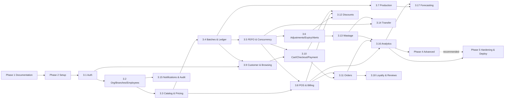

# BakeFlow – Feature Roadmap

> **Step:** 1.1 · **Status:** Draft for owner review · **Source:** Official roadmap from the Phase 1.1 prompt (supersedes the Phase 0–12 numbering in [master-prompt.md](../master-prompt.md)), Appendix D

## Table of Contents

1. [Roadmap at a Glance](#1-roadmap-at-a-glance)
2. [Phase Descriptions](#2-phase-descriptions)
3. [Phase 3 Module Details](#3-phase-3-module-details)
4. [MVP Definition](#4-mvp-definition)
5. [Future Enhancements](#5-future-enhancements)
6. [Dependency Diagram](#6-dependency-diagram)
7. [Related Documents](#7-related-documents)

---

## 1. Roadmap at a Glance

| Phase | Step / Module | Name | MVP |
|-------|---------------|------|-----|
| **1 – Documentation** | 1.1 | Project overview, requirements & key decisions | – |
| | 1.2 | Technology stack documentation | – |
| | 1.3 | Database design & data dictionary | – |
| | 1.4 | Business workflows | – |
| | 1.5 | API documentation | – |
| | 1.6 | System design (HLD/LLD) & diagrams | – |
| | 1.7 | Security, testing & deployment documentation | – |
| | 1.8 | Consistency review & completion report | – |
| **2 – Tech stack & project setup** | 2 | Skeleton, Docker, Flyway, CI, cross-cutting foundations | Yes |
| **3 – Module implementation** | 3.1 | Authentication & authorization | Yes |
| | 3.2 | Organization, branches & employees | Yes |
| | 3.3 | Product catalog & pricing | Yes |
| | 3.4 | Inventory: batches & stock movement ledger | Yes |
| | 3.5 | Inventory: FEFO allocation & concurrency | Yes |
| | 3.6 | Inventory: adjustments, expiry job & alerts | Yes |
| | 3.7 | Production management | Partial |
| | 3.8 | POS & billing (invoices, GST, refunds) | Yes |
| | 3.9 | Customer accounts & catalog browsing | Yes |
| | 3.10 | Cart, checkout, reservation & payment | Yes |
| | 3.11 | Order management & tracking | Yes |
| | 3.12 | Discounts & near-expiry offers | Yes (basic) |
| | 3.13 | Wastage management | Yes |
| | 3.14 | Inter-branch stock transfer | No |
| | 3.15 | Notifications & audit trail | Partial |
| | 3.16 | Analytics & reports | Partial (basic reports) |
| | 3.17 | Demand forecasting & production recommendation | No |
| | 3.18 | Loyalty & reviews | No |
| **4 – Advanced engineering** | 4 | Redis caching, async events, performance | No |
| **5 – Hardening & deployment** | 5 | Security hardening, load tests, production deployment | Yes (needed to go live) |

"Partial" means some of the module's FRs are MVP and the rest are future. The exact split is given per module below.

---

## 2. Phase Descriptions

### Phase 1 – Documentation

**Goal:** A complete, consistent documentation package that acts as the single source of truth. No application code is written.

| Step | Deliverables | Depends on |
|------|--------------|------------|
| 1.1 | Vision, BR, FR, NFR, roles, roadmap, scope & assumptions, ADR log, phase tracking, README | master-prompt.md |
| 1.2 | Technology stack, reasons and alternatives, development environment setup, React ↔ Spring Boot ↔ MySQL communication | 1.1 |
| 1.3 | ER diagram, schema, keys, constraints, indexes, normalisation, `data-dictionary.md`, sample data, key queries | 1.1, 1.2 |
| 1.4 | The 16 business workflows from master-prompt §3.G, with sequence diagrams and examples | 1.3 |
| 1.5 | API documentation for every module (endpoints, auth, JSON examples, errors) | 1.3, 1.4 |
| 1.6 | HLD, LLD and the 9 required Mermaid diagrams | 1.3–1.5 |
| 1.7 | Security (incl. detailed permission matrix), testing strategy, deployment documentation | 1.5, 1.6 |
| 1.8 | Cross-document consistency review and Phase 1 completion report | 1.1–1.7 |

### Phase 2 – Tech stack & project setup

**Goal:** A running, empty-but-production-shaped application.

**Deliverables:** Maven multi-module or package-by-module skeleton (decided in 1.2); React + TypeScript + Tailwind frontend skeleton; Docker Compose (app, MySQL, later Redis); Flyway baseline migration; GitHub Actions CI; global error handling; correlation-ID logging; OpenAPI setup; Testcontainers base test.

**Cross-cutting foundations built here, used by every module:**

- **Audit capture** (BR-15, NFR-29): the audit log table and a reusable way to write audit entries. Viewing and searching come in 3.15.
- **Idempotency support** (ADR-011): the storage and filter used by 3.8 and 3.10.
- **Money and time utilities** (ADR-004, ADR-005).

**Depends on:** Phase 1 complete.

### Phase 3 – Module implementation

18 business modules, detailed in section 3. Each module delivers its Flyway migrations, backend, APIs, frontend screens and tests.

### Phase 4 – Advanced engineering

**Goal:** Performance and scalability beyond the MVP.

**Includes:** Redis caching for catalog and availability (NFR-03, NFR-12); asynchronous domain events for notifications, analytics aggregation and forecasting (for example a transactional outbox); query and index tuning; read replica readiness (NFR-33); nightly ledger reconciliation (NFR-22).

**Depends on:** MVP modules complete.

### Phase 5 – Hardening & deployment

**Goal:** Go live safely.

**Includes:** OWASP review and dependency scanning (NFR-16); load and concurrency tests (NFR-26, 27, 32); backup and restore drills (NFR-09); monitoring and alerting (NFR-46); production deployment; Razorpay live-mode switch (AS-19).

**Depends on:** MVP modules complete. Phase 4 is recommended but not required for a first go-live.

---

## 3. Phase 3 Module Details

### 3.1 Authentication & authorization — MVP: Yes

- **Goal:** Secure login for staff and customers, and the authorization framework (roles, permissions, organization and branch scope).
- **Features:** FR-ADM-13. Provides the authentication foundation used by FR-CUS-01/02 (3.9).
- **Depends on:** Phase 2.

### 3.2 Organization, branches & employees — MVP: Yes

- **Goal:** Set up the organization, its branches and its people.
- **Features:** FR-ADM-01, FR-ADM-02, FR-ADM-03, FR-ADM-16, FR-BR-38.
- **Depends on:** 3.1.

### 3.3 Product catalog & pricing — MVP: Yes

- **Goal:** Central catalog with categories, prices with history, GST data and branch availability.
- **Features:** FR-ADM-04, 05, 06, 08 (MVP); FR-BR-01, 02 (MVP); FR-ADM-07, FR-BR-03, FR-BR-04 (future).
- **Depends on:** 3.2.

### 3.4 Inventory: batches & stock movement ledger — MVP: Yes

- **Goal:** Batch-level stock and the append-only ledger. Stock receipt.
- **Features:** FR-BR-05, 06, 07.
- **Depends on:** 3.3.

### 3.5 Inventory: FEFO allocation & concurrency — MVP: Yes

- **Goal:** One reusable allocation service: FEFO, expiry check, locking, no negative stock. Used by POS, checkout and transfers.
- **Features:** FR-BR-08, 09, 10.
- **Depends on:** 3.4.

### 3.6 Inventory: adjustments, expiry job & alerts — MVP: Yes

- **Goal:** Keep stock true and visible.
- **Features:** FR-BR-11, 12, 13, 14, 34.
- **Depends on:** 3.5.

### 3.7 Production management — MVP: Partial

- **Goal:** Record what was baked as production batches; plan production.
- **Features:** FR-BR-15 (MVP); FR-BR-16 (future).
- **Depends on:** 3.4.

### 3.8 POS & billing (invoices, GST, refunds) — MVP: Yes

- **Goal:** Fast counter billing with GST invoices, gap-free numbering, refunds through credit notes, and daily closing.
- **Features:** FR-BR-20, 21, 23, 24, 25.
- **Depends on:** 3.3, 3.5.
- **Note:** Invoice lines are designed with original price, discount and final price columns from the start, so 3.12 plugs in without reworking invoices.

### 3.9 Customer accounts & catalog browsing — MVP: Yes

- **Goal:** Customers can register, pick a branch and browse real availability.
- **Features:** FR-CUS-01, 02, 03, 04, 05, 06, 07, 08, 20 (MVP); FR-CUS-21, FR-ADM-22 (future).
- **Depends on:** 3.1, 3.3, 3.4.

### 3.10 Cart, checkout, reservation & payment — MVP: Yes

- **Goal:** Cart without reservation; time-limited reservation at checkout; Razorpay payment; webhook reconciliation.
- **Features:** FR-CUS-10, 11, 12, 14 (MVP); FR-CUS-13 (future).
- **Depends on:** 3.5, 3.9.

### 3.11 Order management & tracking — MVP: Yes

- **Goal:** Order lifecycle for customers and branches; cancellation and refund; sale and invoice at handover.
- **Features:** FR-CUS-15, 16, 17, FR-BR-35 (MVP); FR-CUS-25, FR-BR-36 (future).
- **Depends on:** 3.8, 3.10.

### 3.12 Discounts & near-expiry offers — MVP: Yes (basic)

- **Goal:** Configurable near-expiry discount rules, recommendations, approval and manual POS discounts, with the original price never changed.
- **Features:** FR-ADM-14, FR-BR-22, 27, 28, FR-CUS-09 (MVP); FR-BR-26 (future).
- **Depends on:** 3.6, 3.8, 3.10.

### 3.13 Wastage management — MVP: Yes

- **Goal:** Record every unit lost, with reason and cost.
- **Features:** FR-BR-29, 30, FR-ADM-15.
- **Depends on:** 3.6.

### 3.14 Inter-branch stock transfer — MVP: No

- **Goal:** Move stock where it sells, with separate dispatch and receipt.
- **Features:** FR-BR-37.
- **Depends on:** 3.5, 3.13 (transit loss as wastage).

### 3.15 Notifications & audit trail — MVP: Partial

- **Goal:** In-app and email notifications; audit viewing and search.
- **Features:** FR-CUS-18, FR-BR-33, FR-BR-39, FR-ADM-20 (all future).
- **MVP part:** Audit **capture** for every critical action from Phase 2 onward (BR-15). Viewing comes in this module.
- **Depends on:** 3.2 (and events from 3.6, 3.11).

### 3.16 Analytics & reports — MVP: Partial

- **Goal:** Branch and organization reporting.
- **Features:** FR-BR-31, FR-BR-17, FR-ADM-10, FR-ADM-12 (MVP); FR-BR-18, 32, FR-ADM-09, 11, 17 (future).
- **Depends on:** 3.8, 3.11, 3.13.

### 3.17 Demand forecasting & production recommendation — MVP: No

- **Goal:** Recommend tomorrow's production per product per branch.
- **Features:** FR-BR-19, FR-ADM-18.
- **Depends on:** 3.7, 3.16 and at least 8 weeks of sales data (AS-46).

### 3.18 Loyalty & reviews — MVP: No

- **Goal:** Customer retention.
- **Features:** FR-CUS-19, 22, 23, 24, FR-ADM-19, FR-ADM-21.
- **Depends on:** 3.11.

---

## 4. MVP Definition

### 4.1 Mapping Appendix D to modules

| # | Appendix D MVP item | Modules | Key FRs |
|---|---------------------|---------|---------|
| 1 | One organization with multiple branches | 3.2 | FR-ADM-01, 02 |
| 2 | Admin and branch employee login | 3.1, 3.2 | FR-ADM-13, FR-ADM-03, FR-BR-38 |
| 3 | Product catalog | 3.3 | FR-ADM-04–06, 08, FR-BR-01, 02 |
| 4 | Branch-specific inventory | 3.4, 3.5 | FR-BR-06–10 |
| 5 | Batch-wise manufacturing and expiry tracking | 3.4, 3.7 | FR-BR-05, 15 |
| 6 | Stock receiving and stock adjustments | 3.4, 3.6 | FR-BR-05, 11 |
| 7 | POS billing | 3.8 | FR-BR-20, 21, 23–25 |
| 8 | Expiry alerts | 3.6 | FR-BR-12–14, 34 |
| 9 | Basic discounts | 3.12 | FR-ADM-14, FR-BR-22, 27, 28, FR-CUS-09 |
| 10 | Customer product browsing and ordering | 3.9, 3.10, 3.11 | FR-CUS-01–08, 10–12, 14–17, 20, FR-BR-35 |
| 11 | Basic sales and wastage reports | 3.13, 3.16 | FR-BR-29–31, 17, FR-ADM-10, 12, 15 |

### 4.2 Recommended staged MVP (for a single developer)

The full MVP is large for one developer. It is recommended to release it in two stages (see **OQ-06**):

| Stage | Contents | Why |
|-------|----------|-----|
| **MVP-A: Branch operations** | Phase 2, 3.1–3.8, 3.13, basic 3.16, and manual POS discounts from 3.12 | Branches can run day-to-day (production, stock, POS, wastage, reports) without online payment complexity. This delivers wastage visibility early. |
| **MVP-B: Online ordering** | 3.9, 3.10, 3.11, rest of the basic 3.12 (near-expiry rules and offers) | Adds the customer channel once inventory and billing are proven. |

Both stages together form the MVP described in Appendix D. Phase 5 hardening is needed before real go-live.

### 4.3 MVP scope boundaries

- **Pickup only** online; delivery later (OQ-05).
- **Fixed roles**, no custom role editor (AS-22).
- **Production recording**, not production planning or forecasting.
- **Audit captured**, not yet viewable in the UI (3.15).
- **Basic reports only** (daily sales, branch revenue, wastage).

---

## 5. Future Enhancements

### 5.1 Planned post-MVP (in the official roadmap)

| Feature | Module | FRs |
|---------|--------|-----|
| Delivery and customer addresses | 3.10, 3.9, 3.11 | FR-CUS-13, 21, FR-BR-36 |
| Branch price overrides and pricing rules | 3.3 | FR-ADM-07, FR-BR-03 |
| Branch category display | 3.3 | FR-BR-04 |
| Production planning | 3.7 | FR-BR-16 |
| Branch-level discount rules | 3.12 | FR-BR-26 |
| Inter-branch transfer | 3.14 | FR-BR-37 |
| Notifications and audit viewing | 3.15 | FR-CUS-18, FR-BR-33, 39, FR-ADM-20 |
| Advanced analytics and dashboards | 3.16 | FR-BR-18, 32, FR-ADM-09, 11, 17 |
| Demand forecasting | 3.17 | FR-BR-19, FR-ADM-18 |
| Loyalty, favourites, reviews, personalised offers | 3.18 | FR-CUS-19, 22–24, FR-ADM-19, 21 |
| Customer invoice download, customer admin | 3.11, 3.9 | FR-CUS-25, FR-ADM-22 |
| Redis caching, async events, performance | Phase 4 | NFR-03, 12, 33 |

### 5.2 Beyond the current roadmap (ideas only, not committed)

These are listed in [scope-and-assumptions.md](scope-and-assumptions.md#2-out-of-scope): raw material and recipe inventory, supplier purchase orders, central kitchen, custom cake pre-orders, scheduled pickup slots, offline POS, third-party delivery aggregators, SMS/WhatsApp notifications, native mobile apps, multi-language UI.

---

## 6. Dependency Diagram

**How to read it:** an arrow from A to B means "B needs A to be finished first". The dotted arrow means "recommended, not required". Example: POS billing (3.8) needs the catalog (3.3) for prices and FEFO allocation (3.5) to take stock.

---

## 7. Related Documents

- [functional-requirements.md](functional-requirements.md)
- [scope-and-assumptions.md](scope-and-assumptions.md)
- [implementation-status.md](../09-phase-tracking/implementation-status.md)
