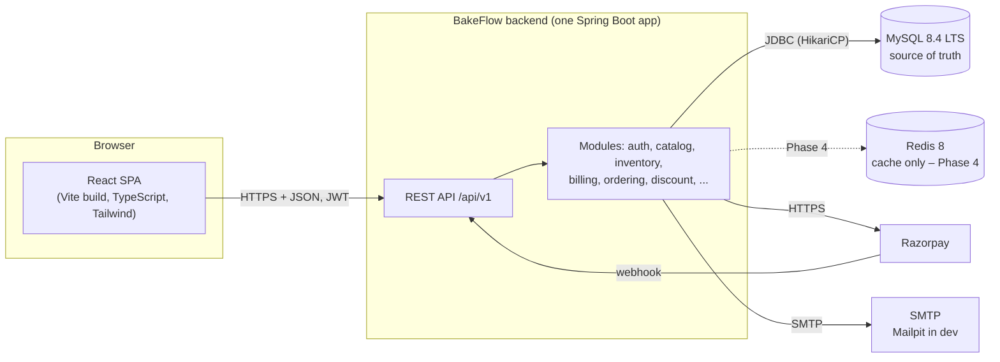

# BakeFlow – Technology Stack

> **Step:** 1.2 · **Status:** Draft for owner review · **Versions checked:** 24-Nov-2026 · **Source:** [master-prompt.md](../master-prompt.md) §2, [design-decisions.md](../02-system-design/design-decisions.md)

## Table of Contents

1. [Overview](#1-overview)
2. [Stack by Layer](#2-stack-by-layer)
3. [Spring Boot 4.x vs 3.5.x Assessment](#3-spring-boot-4x-vs-35x-assessment)
4. [Version Table](#4-version-table)
5. [Version Policy](#5-version-policy)
6. [Rejected or Deferred Technologies](#6-rejected-or-deferred-technologies)
7. [Related Documents](#7-related-documents)

---

## 1. Overview

BakeFlow is a **modular monolith** ([ADR-001](../02-system-design/design-decisions.md#adr-001--modular-monolith-architecture)). It has a Spring Boot backend, a single React single-page application (SPA) for all three areas (customer, branch, admin), and MySQL as the only source of truth.

**Legend for this document**

- ✅ **Accepted**: part of the stack.
- ⏳ **Deferred**: accepted, but introduced in a later phase.
- ❌ **Rejected**: not used, with the reason.

Why each choice was made, and the alternatives considered, are in [technology-justification.md](technology-justification.md).

---

## 2. Stack by Layer

### 2.1 Backend

| Technology | Decision | What it does in BakeFlow | Reason (short) |
|-----------|----------|---------------------------|----------------|
| **Java 21 (LTS)** | ✅ | Programming language and runtime | Required by the brief; long-term support; records, pattern matching, virtual threads. Java 25 LTS considered (OQ-24). |
| **Spring Boot 4.1.x** | ✅ | Application framework: configuration, embedded server, dependency management | Industry standard; 3.5 is out of open-source support ([section 3](#3-spring-boot-4x-vs-35x-assessment), [ADR-016](../02-system-design/design-decisions.md#adr-016--spring-boot-41x-on-java-21-lts)) |
| **Spring Web (MVC)** | ✅ | REST controllers, JSON over HTTP, embedded Tomcat | Simple blocking model fits CRUD and transactional workloads. WebFlux is not needed. |
| **Spring Validation** (Jakarta Bean Validation / Hibernate Validator) | ✅ | Validates request bodies (`@NotNull`, `@Size`, `@Positive`) | Declarative, consistent field errors (NFR-38) |
| **Spring Data JPA + Hibernate 7** | ✅ | Maps Java entities to MySQL tables; repositories; locking (`@Lock`, `@Version`) | Standard ORM; supports pessimistic and optimistic locking (ADR-008) |
| **Spring Security 7** | ✅ | Authentication, authorization, password hashing (BCrypt), CORS, security headers | Mature, integrated with Spring; method-level security for branch scope (BR-14) |
| **JWT: Spring Security OAuth2 Resource Server (Nimbus JOSE + JWT)** | ✅ | Issues and validates JWT access tokens | Built into Spring Security and version-managed by Spring Boot; no extra library ([ADR-023](../02-system-design/design-decisions.md#adr-023--jwt-with-spring-security-resource-server-nimbus-not-jjwt)) |
| JJWT | ❌ | – | Good library, but an extra dependency doing what Spring Security already provides |
| **Flyway** (+ `flyway-mysql`) | ✅ | Versioned SQL migrations | ADR-003. Spring Boot 4 needs `spring-boot-starter-flyway` plus `flyway-mysql` |
| **springdoc-openapi 3.x** | ✅ | Generates the OpenAPI spec and Swagger UI from controllers | Brief asks for Swagger/OpenAPI (NFR-43); the 3.x line targets Spring Boot 4 |
| **Spring Boot Actuator + Micrometer** | ✅ | Health, readiness, metrics endpoints; Prometheus format later | NFR-46 |
| **Spring Data Redis** | ⏳ Phase 4 | Cache abstraction backed by Redis | Brief lists Redis; cache only, never stock truth ([ADR-030](../02-system-design/design-decisions.md#adr-030--redis-for-caching-only-introduced-in-phase-4)) |
| **Spring Modulith 2.x** | ✅ | Verifies module boundaries in tests; documents modules; module-level integration tests | Enforces the modular monolith (NFR-42, [ADR-020](../02-system-design/design-decisions.md#adr-020--package-by-module-structure-enforced-by-spring-modulith-and-archunit)) |
| **ArchUnit** | ✅ | Layer rules **inside** each module (for example controllers never call repositories) | Complements Spring Modulith, which checks rules **between** modules |
| **MapStruct 1.6.x** | ✅ | Generates entity ↔ DTO mapping code at compile time | No reflection, compile-time errors on unmapped fields ([ADR-022](../02-system-design/design-decisions.md#adr-022--mapstruct-for-dto-mapping)) |
| **Lombok** | ❌ | – | Decided **no**: Java records cover DTOs; entity boilerplate is small; avoids annotation-processor and JPA pitfalls ([ADR-021](../02-system-design/design-decisions.md#adr-021--no-lombok-java-records-for-dtos)) |
| **ShedLock** | ✅ (from 3.6) | Ensures a scheduled job (expiry, reservation release, no-show) runs on only one instance at a time | Safe when more than one backend instance runs (NFR-35, [ADR-025](../02-system-design/design-decisions.md#adr-025--shedlock-for-scheduled-jobs)) |
| **Spring `RestClient`** | ✅ | Outbound HTTP calls where no SDK is used | `RestTemplate` is deprecated from Spring Boot 4.2 |
| **Spring Mail** | ✅ (MVP-B) | Sends password-reset and notification emails over SMTP | AS-58, [ADR-033](../02-system-design/design-decisions.md#adr-033--email-via-spring-mail-mailpit-in-development) |
| **Jackson 3** | ✅ (managed) | JSON serialisation | Default in Spring Boot 4. Note: package names changed to `tools.jackson` |

### 2.2 Frontend

| Technology | Decision | What it does in BakeFlow | Reason (short) |
|-----------|----------|---------------------------|----------------|
| **Vite 8** | ✅ | Dev server with hot reload; production build | Fast, simple SPA tooling ([ADR-026](../02-system-design/design-decisions.md#adr-026--single-react-spa-built-with-vite-not-nextjs)) |
| **React 19.2** | ✅ | UI library | Required by the brief; largest ecosystem |
| **TypeScript (strict)** | ✅ | Typed JavaScript; `"strict": true` | Catches errors early; documents API shapes |
| **Tailwind CSS 4** | ✅ | Utility-first styling via the `@tailwindcss/vite` plugin | Required by the brief; fast to build consistent, responsive screens |
| **React Router** | ✅ | Client-side routes for `/shop`, `/branch`, `/admin` areas, used in SPA ("data/declarative") mode | Standard router; supports lazy-loaded route areas |
| **TanStack Query** | ✅ | Server-state management: fetching, caching, retries, invalidation | Removes most of the need for a global store ([ADR-027](../02-system-design/design-decisions.md#adr-027--frontend-data-layer-tanstack-query-axios-react-hook-form-zod-no-redux)) |
| **Axios** | ✅ | HTTP client with interceptors (attach JWT, refresh on 401, correlation ID) | Interceptors make token refresh simple |
| **React Hook Form + Zod** (+ `@hookform/resolvers`) | ✅ | Forms with schema validation; types derived from schemas | Fast forms (POS), one schema for validation and types |
| **Recharts** | ✅ (from 3.16) | Charts for reports and dashboards | React-native API, enough for line, bar and pie charts |
| **lucide-react** | ✅ | Icons | Consistent open-source icon set, tree-shakable |
| Redux / Redux Toolkit | ❌ | – | Server state lives in TanStack Query; little client state remains |
| **openapi-typescript** | ✅ (from 3.1) | Generates TypeScript types from the backend's OpenAPI spec | Keeps frontend types in sync with the API (suggestion; can be dropped) |
| **ESLint + Prettier** | ✅ | Linting and formatting | Consistent code; runs in CI |

### 2.3 Database and cache

| Technology | Decision | Purpose | Reason (short) |
|-----------|----------|---------|----------------|
| **MySQL 8.4 LTS** | ✅ | Primary relational database, the single source of truth | Brief requires MySQL 8. **MySQL 8.0 reached end of life on 30-Apr-2026**, so 8.4 LTS is used ([ADR-019](../02-system-design/design-decisions.md#adr-019--mysql-84-lts)) |
| **InnoDB, `utf8mb4`, `utf8mb4_0900_ai_ci`** | ✅ | Storage engine and character set | Transactions and row locks; full Unicode (₹, Tamil names) |
| **HikariCP** | ✅ (managed) | JDBC connection pool | Spring Boot default; fast and reliable |
| **MySQL Connector/J** | ✅ (managed) | JDBC driver | Official driver; version managed by Spring Boot |
| **Redis 8** | ⏳ Phase 4 | Cache for catalog, availability summaries, idempotency look-ups | Brief lists Redis; **never** the source of truth for stock |

### 2.4 Security

| Technology / practice | Decision | Purpose |
|----------------------|----------|---------|
| Spring Security 7 | ✅ | Filter chain, authorization rules, method security |
| JWT (HS256, short-lived access token) | ✅ | Stateless authentication (NFR-14, ADR-023) |
| Refresh token in **HttpOnly, Secure, SameSite=Strict cookie**; access token kept **in memory** | ✅ | Reduces token theft by XSS ([ADR-024](../02-system-design/design-decisions.md#adr-024--token-storage-in-the-browser-and-same-origin-deployment)) |
| BCrypt (cost ≥ 12) | ✅ | Password hashing (NFR-13) |
| Bean Validation + parameterised queries (JPA) | ✅ | Input validation; SQL injection prevention (NFR-16) |
| Razorpay signature verification | ✅ | Payment and webhook integrity (NFR-18) |
| OWASP Dependency-Check or GitHub Dependabot alerts | ✅ (Phase 2 CI) | Vulnerable dependency detection |
| Rate limiting library (for example Bucket4j) | ⏳ Phase 5 | Login throttling (NFR-19) may start as a simple database counter |

Detailed security design: *Planned – created in step 1.7*.

### 2.5 Testing

| Technology | Decision | Purpose | Phase first used |
|-----------|----------|---------|------------------|
| **JUnit Jupiter** (the JUnit 5 programming model; Spring Boot 4 manages the current JUnit release, which keeps the Jupiter API) | ✅ | Test framework | 2 |
| **Mockito** | ✅ | Mocks for unit tests | 2 |
| **AssertJ** | ✅ | Readable assertions | 2 |
| **Spring Boot Test** (`@SpringBootTest`, `@WebMvcTest`, `@DataJpaTest`) | ✅ | Slice and full-context tests | 2 |
| **Spring Security Test** | ✅ | Tests with mocked users and roles; authorization tests (NFR-15) | 3.1 |
| **Testcontainers 2.x** (MySQL, later Redis) with `@ServiceConnection` | ✅ | Real MySQL in Docker for integration and concurrency tests (NFR-26) | 2 |
| **Spring Modulith test support** (`@ApplicationModuleTest`) | ✅ | Tests one module in isolation | 2 |
| **ArchUnit** | ✅ | Architecture rules as tests | 2 |
| **WireMock** | ✅ | Fake Razorpay API in tests | 3.10 |
| **Vitest 4** + **React Testing Library** + `jsdom` | ✅ | Frontend unit and component tests | 2 |
| **MSW (Mock Service Worker)** | ✅ | Mocks API calls in frontend tests | 3.1 |
| **Playwright** | ⏳ Phase 5 | End-to-end browser tests of key flows (POS bill, checkout) | 5 |
| **JaCoCo** | ✅ | Coverage reports for NFR-41 | 2 |

### 2.6 Build and tooling

| Technology | Decision | Purpose |
|-----------|----------|---------|
| **Maven 3.9.x via Maven Wrapper (`mvnw`)** | ✅ | Backend build; everyone uses the same Maven version ([ADR-018](../02-system-design/design-decisions.md#adr-018--maven-with-the-maven-wrapper)) |
| Gradle | ❌ | Capable, but Maven is required by the brief and simpler to read for learning |
| **npm** (with `package-lock.json`) | ✅ | Frontend package manager; `npm ci` in CI for reproducible installs |
| pnpm / Yarn | ❌ | Fine alternatives; npm ships with Node, one less tool |
| **Node.js 26 LTS** (via `fnm`) | ✅ | Runs Vite, tests and the frontend build |
| **SDKMAN!** | ✅ | Installs and switches JDKs on the developer machine |

### 2.7 DevOps

| Technology | Decision | Purpose | Phase |
|-----------|----------|---------|-------|
| **Docker** | ✅ | Containers for MySQL, Mailpit, Redis (dev) and the application images (deployment) | 2 |
| **Docker Compose v2** | ✅ | Starts local services with one command; later the deployment stack | 2 |
| **GitHub Actions** | ✅ | CI: build, tests (incl. Testcontainers), lint, coverage, dependency check; CD later | 2 |
| **Dependabot** | ✅ | Automated dependency update pull requests | 2 |
| Nginx (or Caddy) reverse proxy | ⏳ Phase 5 | Serves the built SPA and proxies `/api` on the same origin (ADR-024) | 5 |
| Kubernetes | ❌ | Far more than one app and one database need | – |

Docker files and the CI workflow are created in Phase 2. Deployment details: *Planned – created in step 1.7*.

### 2.8 Observability

| Technology | Decision | Purpose | Phase |
|-----------|----------|---------|-------|
| **Spring Boot structured logging (JSON, ECS format)** | ✅ | Machine-readable logs with correlation ID, user ID and branch ID (NFR-45). Built in; no extra library | 2 |
| **SLF4J + Logback** | ✅ (managed) | Logging API and implementation | 2 |
| **Actuator health/readiness** | ✅ | Liveness and readiness checks | 2 |
| **Micrometer + Prometheus registry** | ⏳ | Metrics export | 5 |
| **Prometheus + Grafana** | ⏳ | Metrics storage and dashboards | 5 |
| **Micrometer Tracing / OpenTelemetry** | ⏳ | Distributed tracing. Optional, since BakeFlow is a single application | 5 (optional) |

### 2.9 External and development services

| Service | Decision | Purpose | Phase |
|---------|----------|---------|-------|
| **Razorpay (test mode)** via the official **`razorpay-java` SDK**, behind a `PaymentGateway` interface | ✅ | Online payments, refunds, webhook signature verification (ADR-007, [ADR-034](../02-system-design/design-decisions.md#adr-034--razorpay-integration-through-the-official-java-sdk-behind-paymentgateway)) | 3.10 |
| **Invoice printing: browser print with print CSS** (80 mm thermal and A4) | ✅ | Printable invoices at the counter with no server PDF needed (NFR-40, [ADR-032](../02-system-design/design-decisions.md#adr-032--invoice-printing-browser-print-first-server-pdf-later)) | 3.8 |
| **Server-side PDF: OpenHTMLtoPDF** (HTML template → PDF) | ⏳ | PDF invoices for email or customer download (FR-CUS-25) | Post-MVP |
| **Mailpit** (local SMTP server with web inbox) | ✅ | Catches all emails in development; nothing reaches real inboxes | 2 (container), MVP-B (used) |
| Production SMTP provider (for example Amazon SES, Brevo, Zoho ZeptoMail) | ⏳ | Real email delivery | Chosen in step 1.7 |
| **SMS / WhatsApp** (for example MSG91, Gupshup, Twilio) | ❌ Future | Out of scope (OS-09). Note: commercial SMS in India requires **DLT registration** of the sender and templates | Future |
| File storage: local disk volume behind a `FileStorage` interface; S3-compatible later | ✅ | Product images (AS-34, [ADR-031](../02-system-design/design-decisions.md#adr-031--file-storage-behind-an-interface-local-disk-first)) | 3.3 |

---

## 3. Spring Boot 4.x vs 3.5.x Assessment

### 3.1 Facts (checked 24-Nov-2026 against spring.io)

| Line | Status | Latest release |
|------|--------|----------------|
| **3.5.x** | **Open-source support ended 30-Jun-2026.** Only paid commercial support remains. | 3.5.16 (25-Jun-2026), the last open-source patch |
| 4.0.x | Supported | 4.0.10 (20-Nov-2026) |
| **4.1.x** | Supported, mature (GA in 2026; 3 patch releases) | **4.1.3 (20-Nov-2026)** |
| 4.2.x | Supported, brand new | 4.2.0 (19-Nov-2026) |

### 3.2 Compatibility of key libraries

| Library | With Spring Boot 3.5.x | With Spring Boot 4.x | Verdict for 4.1 |
|---------|------------------------|----------------------|-----------------|
| **springdoc-openapi** | 2.8.x line | **3.x line** (3.0.0 was built on Spring Boot 4.0) | ✅ Compatible. Confirm the exact 3.x patch for 4.1 in Phase 2 |
| **Testcontainers** | 1.21.x | **2.x**, managed by the Spring Boot 4 BOM. JUnit 4 rules removed (BakeFlow uses JUnit 5 anyway) | ✅ Compatible; version comes from Boot |
| **Flyway + MySQL** | `flyway-core` + `flyway-mysql` | **`spring-boot-starter-flyway` + `flyway-mysql`** (Boot 4 split auto-configuration into modules). Flyway version managed by Boot (12.x reported for 4.1) | ✅ Compatible; remember the new starter |
| **Spring Modulith** | 1.4.x | **2.x** (2.0 GA was built on Boot 4; 2.1.x targets Boot 4.1) | ✅ Compatible |
| MapStruct | 1.6.x | 1.6.x (an open issue reports a bean-creation problem on Boot 4.0.2) | ⚠️ Check in the Phase 2 spike |
| Lombok | Works | Issues reported on Boot 4 | Not used (ADR-021) |
| ShedLock | 5.x/6.x | 7.x line expected; no explicit Boot 4 statement found | ⚠️ Check in the Phase 2 spike (needed only from 3.6) |

### 3.3 Recommendation

**Use Spring Boot 4.1.x (pin 4.1.3 or the latest 4.1 patch at Phase 2 start).**

- **Not 3.5.x:** starting a new project on a line without open-source security patches is not acceptable. Migrating from 3.5 to 4 later (Jakarta EE 11, Jackson 3, Hibernate 7, Security 7) would cost more than starting on 4.
- **Not 4.2.0 yet:** it is five days old, and libraries outside Spring (springdoc, ShedLock, MapStruct) usually need a few weeks to publish confirmed compatible releases. 4.1 already has three patch releases.
- **Plan:** upgrade to 4.2.x **before Phase 5**, once springdoc and Spring Modulith confirm support (OQ-25). Minor upgrades within 4.x are small.

**What changes compared with older Spring Boot tutorials (important when learning):**

- Jackson 3: imports change from `com.fasterxml.jackson` to `tools.jackson` (annotations stay the same).
- Modular starters: for example Flyway needs `spring-boot-starter-flyway`.
- `RestClient` replaces `RestTemplate` (deprecated from 4.2).
- Hibernate 7 and Spring Security 7: some older configuration styles are removed.
- Many online examples still target 3.x. Always check the version of a tutorial.

---

## 4. Version Table

**Status column meaning**

- **Verified** – checked from official or primary sources on 24-Nov-2026.
- **Boot-managed** – the version is set by Spring Boot's dependency BOM, so we do not pin it ourselves; it is fixed once Spring Boot is pinned.
- **To verify in Phase 2** – the release line is chosen; the exact patch is confirmed (Maven Central / npm) when build files are created.

### 4.1 Backend and data

| Technology | Version | Status | Purpose | First used |
|-----------|---------|--------|---------|-----------|
| Java (Eclipse Temurin) | 21 LTS (latest 21.0.x patch) | To verify in Phase 2 (patch) | Runtime | 2 |
| Spring Boot | **4.1.3** | Verified (spring.io, 20-Nov-2026) | Framework and BOM | 2 |
| Spring Framework / Security / Data | 7.0.x / 7.x / per Boot 4.1 | Boot-managed | Core, security, JPA | 2 |
| Hibernate ORM | 7.x (7.4.x per Boot 4.1 release notes) | Boot-managed | ORM | 2 |
| Jackson | 3.x | Boot-managed | JSON | 2 |
| Flyway (+ `flyway-mysql`) | 12.x (reported for Boot 4.1) | Boot-managed | Migrations | 2 |
| MySQL Connector/J | 9.x | Boot-managed | JDBC driver | 2 |
| HikariCP | per Boot 4.1 | Boot-managed | Connection pool | 2 |
| springdoc-openapi-starter-webmvc-ui | 3.x (latest compatible with Boot 4.1) | To verify in Phase 2 | OpenAPI + Swagger UI | 2 |
| Spring Modulith | 2.1.x | To verify in Phase 2 (2.1.2 released 23-Oct-2026 per spring.io) | Module boundaries | 2 |
| ArchUnit (`archunit-junit5`) | 1.x latest | To verify in Phase 2 | Layer rules | 2 |
| MapStruct | 1.6.x | To verify in Phase 2 | DTO mapping | 2 |
| ShedLock (`shedlock-spring`, JDBC provider) | 7.x | To verify in Phase 2 | Scheduled job locking | 3.6 |
| razorpay-java | latest 1.x | To verify before 3.10 | Payments | 3.10 |
| OpenHTMLtoPDF (`io.github.openhtmltopdf`) | latest | To verify when needed | Server PDF | Post-MVP |
| MySQL Server (Docker image `mysql:8.4`) | 8.4 LTS, latest patch | Verified line (8.0 EOL 30-Apr-2026) | Database | 2 |
| Redis (Docker image `redis:8`) | 8.x | To verify in Phase 4 | Cache | 4 |
| Spring Data Redis | per Boot | Boot-managed | Redis client | 4 |
| Mailpit (Docker image `axllent/mailpit`) | latest 1.x | To verify in Phase 2 | Dev SMTP | 2 |

### 4.2 Testing

| Technology | Version | Status | First used |
|-----------|---------|--------|-----------|
| JUnit Jupiter | 5.x / 6.x per Boot 4.1 | Boot-managed | 2 |
| Mockito | per Boot | Boot-managed | 2 |
| AssertJ | per Boot | Boot-managed | 2 |
| Testcontainers | 2.x | Boot-managed | 2 |
| WireMock | latest 3.x | To verify before 3.10 | 3.10 |
| JaCoCo Maven plugin | latest 0.8.x | To verify in Phase 2 | 2 |
| Vitest | 4.1.x | Verified line (4.1 released Mar-2026) | 2 |
| React Testing Library | latest 16.x | To verify in Phase 2 | 2 |
| MSW | latest 2.x | To verify in Phase 2 | 3.1 |
| Playwright | latest 1.x | To verify in Phase 5 | 5 |

### 4.3 Frontend

| Technology | Version | Status | First used |
|-----------|---------|--------|-----------|
| Node.js | **26 LTS** | Verified (LTS since Oct-2026, EOL Apr-2029) | 2 |
| npm | bundled with Node 26 | – | 2 |
| Vite | **8.x** (8.1 released Jun-2026) | Verified line | 2 |
| React / React DOM | **19.2.x** | Verified line | 2 |
| TypeScript | **7.0.x** (released 8-Jul-2026); fallback 6.0.x | To verify in Phase 2: ESLint and editor tooling support for 7.0 | 2 |
| Tailwind CSS (+ `@tailwindcss/vite`) | **4.1.x** | Verified line | 2 |
| React Router | **8.x** (released Jun-2026; `react-router-dom` package removed) | Verified line; confirm SPA mode setup in Phase 2 | 2 |
| TanStack Query (`@tanstack/react-query`) | latest stable major (v5, or v6 if confirmed) | To verify in Phase 2 | 2 |
| Axios | 1.x latest | To verify in Phase 2 | 2 |
| React Hook Form | 7.x | To verify in Phase 2 | 3.1 |
| Zod | 4.x | To verify in Phase 2 | 3.1 |
| @hookform/resolvers | latest compatible with Zod 4 | To verify in Phase 2 | 3.1 |
| Recharts | 3.x | To verify before 3.16 | 3.16 |
| lucide-react | latest | To verify in Phase 2 | 2 |
| openapi-typescript | latest 7.x | To verify in Phase 2 | 3.1 |
| ESLint (flat config) + typescript-eslint | latest stable | To verify in Phase 2 | 2 |
| Prettier (+ Tailwind plugin) | 3.x | To verify in Phase 2 | 2 |

### 4.4 Tooling and DevOps

| Technology | Version | Status | First used |
|-----------|---------|--------|-----------|
| Maven (via wrapper) | 3.9.x latest | To verify in Phase 2 | 2 |
| Docker Desktop (or Colima, OQ-26) | latest | Install-time | 2 |
| Docker Compose | v2 (bundled) | Install-time | 2 |
| GitHub Actions: `actions/checkout`, `actions/setup-java`, `actions/setup-node` | latest major of each | To verify in Phase 2 | 2 |

---

## 5. Version Policy

Rules for choosing and changing versions ([ADR-017](../02-system-design/design-decisions.md#adr-017--dependency-version-policy)):

1. **Pin exact versions.** No ranges, `LATEST` or `^`/`~` in build files. Maven: explicit versions. npm: `save-exact=true` in `.npmrc`, and `package-lock.json` committed.
2. **Let the Spring Boot BOM manage what it manages.** Pin Spring Boot itself and do not override versions it manages unless there is a documented reason (for example a security fix), recorded in [technical-debt.md](../09-phase-tracking/technical-debt.md).
3. **Choose the latest stable release with full ecosystem compatibility**, not simply the newest. A new major or minor line is adopted only when the libraries that depend on it have published compatible releases.
4. **Avoid brand-new releases for 14 days**, except security fixes. This lowers the risk of early bugs and of compromised packages (supply-chain attacks).
5. **Upgrade deliberately.** Dependabot opens pull requests weekly. Patch updates are merged when CI is green. Minor and major updates get their own branch, a short note in the change log, and full test runs.
6. **Record verification.** Every Phase 2 pin is checked against Maven Central or npm, and this table is updated with the exact version and date.
7. **LTS runtimes only:** Java and Node use LTS releases; MySQL uses the LTS line.

---

## 6. Rejected or Deferred Technologies

| Technology | Status | Reason | Reconsider when |
|-----------|--------|--------|-----------------|
| Microservices | ❌ | ADR-001 | A module needs independent scaling or a separate team |
| Spring WebFlux (reactive) | ❌ | Blocking JDBC/JPA and transactional logic fit MVC better; simpler to learn and debug | Very high concurrency streaming needs |
| Lombok | ❌ | ADR-021 | – |
| JJWT | ❌ | ADR-023 | If tokens must be handled outside Spring Security |
| Redux | ❌ | ADR-027 | Complex client-only state appears |
| Next.js | ❌ | ADR-026 (no SEO-critical pages; SSR adds a Node server) | Public marketing pages need SEO |
| PostgreSQL | ❌ | Brief requires MySQL; both would work ([justification](technology-justification.md#21-mysql-vs-postgresql)) | – |
| Liquibase | ❌ | ADR-003 | – |
| Gradle | ❌ | ADR-018 | – |
| Kafka / RabbitMQ | ❌ | In-process events (Spring Modulith) are enough for a monolith | Modules are extracted into services |
| Kubernetes | ❌ | Too heavy for one app + one database | Many instances and services |
| Elasticsearch | ❌ | MySQL full-text search or `LIKE` on 1,000 products is enough | Catalog grows to tens of thousands of items |
| iText (PDF) | ❌ | AGPL / commercial licence | – |
| JasperReports | ❌ | Heavy designer-based tooling for simple invoices | Complex formatted reports needed |

---

## 7. Related Documents

- [technology-justification.md](technology-justification.md) – why, alternatives, how the parts communicate
- [development-environment.md](development-environment.md) – macOS setup
- [coding-conventions.md](coding-conventions.md) – naming and structure rules
- [design-decisions.md](../02-system-design/design-decisions.md) – ADR-016 to ADR-034
- [non-functional-requirements.md](../00-project-overview/non-functional-requirements.md)

**Sources used for version checks (24-Nov-2026):** spring.io blog (Spring Boot 4.2.0, 4.1.3, 4.0.10, 3.5.16 announcements; Spring Modulith releases), Spring Boot dependency-versions documentation, springdoc-openapi GitHub releases, Oracle MySQL 8.0 release notes (end of life), nodejs.org release schedule, vite.dev blog, Microsoft TypeScript blog (7.0 announcement), vitest.dev blog, react.dev blog, reactrouter.com changelog, redis.io licence page.
